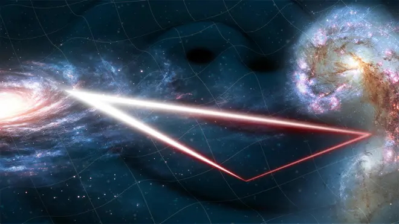

On 25 January 2024, ESA's Science Programme Committee formally [adopted the Laser Interferometer Space Antenna (LISA)](https://www.esa.int/Science_Exploration/Space_Science/LISA/Capturing_the_ripples_of_spacetime_LISA_gets_go-ahead) as the third large-class (L3) mission of its Cosmic Vision programme, alongside the Venus orbiter EnVision ([ESA press release N° 4–2024](https://www.esa.int/Newsroom/Press_Releases/Venus_voyager_and_gravitational_wave_surfer_get_green_light)). "Adoption" is the milestone where ESA finally recognises that the mission concept and technology are mature enough, and gives the green light to actually build the spacecraft and instruments. It marks the end of a journey that started more than four decades ago! The idea of a space-based gravitational-wave observatory first emerged in the late 1970s, and in the decades that followed, the maturing LISA concept faced [several obstacles](https://www.nbcnews.com/id/wbna42497305). In the early 2010s, after NASA withdrew from the partnership, the European community had to proceed alone, essentially proposing a mission with a reduced design.

Spirits remained high, however: in 2013 ESA chose "The Gravitational Universe" as the science theme for its L3 slot, and in 2017 it selected the LISA concept to address it. Crucially, the [LISA Pathfinder](https://sci.esa.int/web/lisa-pathfinder) mission, which I had the privilege to work on, demonstrated in flight that test masses can be kept in near-perfect free fall, at a level that made LISA's measurement concept credible. Since adoption, things have moved fast: in June 2025 ESA [signed the contract with OHB System AG](https://www.esa.int/Science_Exploration/Space_Science/LISA/Construction_of_ESA_s_ambitious_LISA_mission_begins) as prime contractor to build the three spacecraft, with launch planned for 2035 on an Ariane 6 rocket.

LISA will consist of three spacecraft trailing the Earth in its orbit around the Sun, forming an equilateral triangle with arms 2.5 million km long, more than six times the Earth–Moon distance. Laser links between the spacecraft will track distance changes of a few picometres, opening the millihertz band of the gravitational-wave spectrum, which is inaccessible from the ground. In this band we expect to hear mergers of massive black holes at the centres of galaxies across cosmic history, stellar-mass compact objects spiralling into them (extreme mass-ratio inspirals), tens of thousands of compact binaries in our own Galaxy, and possibly stochastic backgrounds from the early Universe. As ESA's LISA project scientist Oliver Jennrich put it, capturing these ripples "will be a real game-changer, like when sound was added to motion pictures." For those of us in the LISA Consortium working on the data analysis, adoption also means that the challenge of disentangling all these overlapping signals from a single data stream, the so-called "global fit", is no longer a far-future exercise. It is now a concrete engineering task with a deadline.

_Good times!_ 

